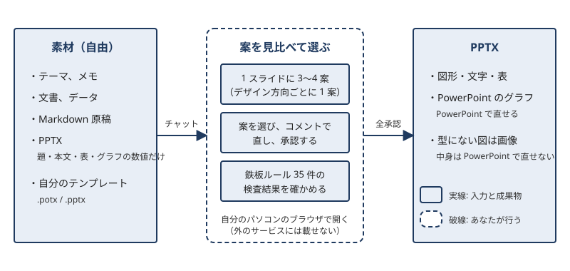
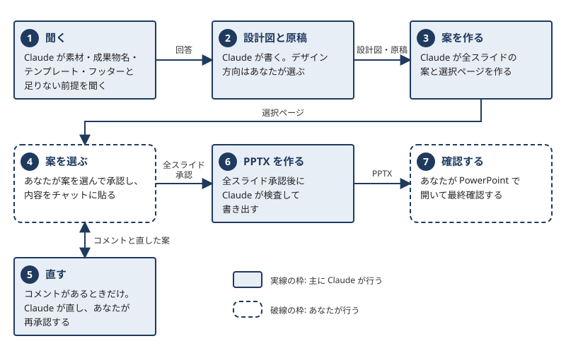
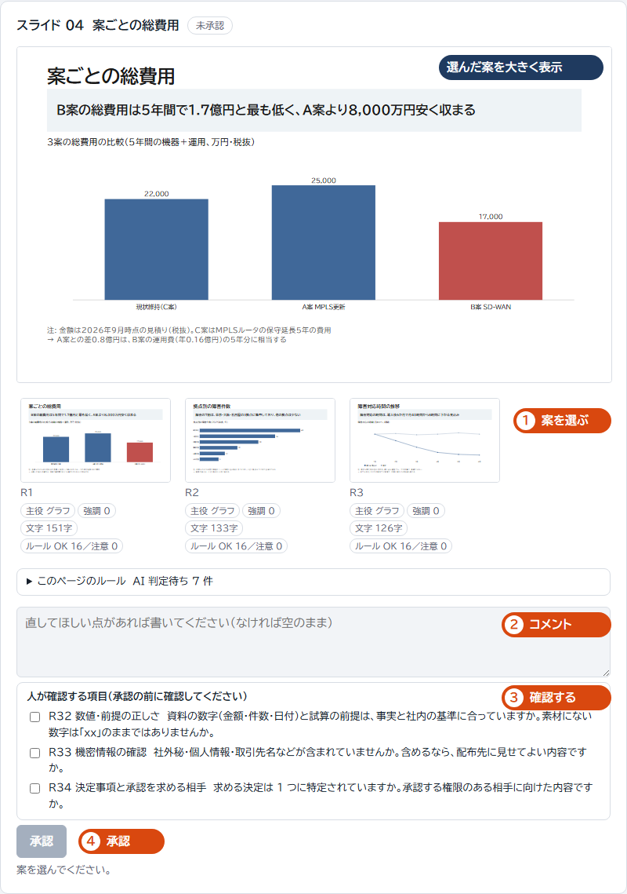
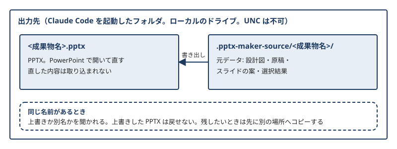

# pptx-maker

稟議書・提案書・障害報告を、PowerPoint で直せる PPTX（.pptx ファイル）にする Claude Code プラグイン（Windows 専用）。素材をチャットで渡し、スライドの案を選ぶと、コンサル資料のテイストの資料ができる。

```
/pptx-maker:create 新サーバー導入の稟議資料を作って
```



## 機能

全スライドに 2〜4 案（レイアウトの違う案）を作り、ブラウザの案の選択ページで、スライドごとに選択・コメント・承認をする。コンサル資料の鉄板ルール 35 件の検査結果も、そこで確かめる。

| 項目 | できること | できないこと |
|---|---|---|
| 素材 | テーマ・メモ・文書・データ・Markdown 原稿・PPTX を読む。 | PPTX のノート・非表示スライド・画像を読む。 |
| 出力 | 図形・文字・表・PowerPoint のグラフで、PowerPoint で直せる PPTX を作る。 | PowerPoint で直した内容を取り込む。 |
| テンプレート | `.potx`・`.pptx` を登録し、その表紙・本文・裏表紙の上に作る。 | 3 つ以外のレイアウトを使う。 |
| 図 | 型にない図は、`/pptx-maker:create` で「図にして」と頼むと画像で貼る。 | 画像の中身を PowerPoint で直す。 |

Claude Code で打つコマンドは、次の 4 つ。文章で頼んでも起動しないので、コマンドで呼ぶ。内部で使うコマンドは [docs/development.md](docs/development.md#コマンド) にある。

- `/pptx-maker:create`: 資料や図を新しく作成する。図だけの依頼は、表紙と図のスライドの 2 枚にする。
- `/pptx-maker:doctor`: 環境を診断し、最新版かを確かめる。何も変更しない。
- `/pptx-maker:template`: 自分のテンプレートの登録・一覧表示・削除をする。
- `/pptx-maker:rules`: 鉄板ルールを対話で追加・編集・無効化・有効化・削除・既定に戻す・一覧表示をする。

## 導入方法

次がそろっていること。

- Windows、Claude Code、Microsoft PowerPoint（最終確認と、作成後の直しに使う）
- Python 3.12 以上（`venv` と `ensurepip` 付き。`python` が PATH にあること）
- ネットワーク接続（初回に、Python のライブラリとブラウザ（Chromium。数百 MB）を取得する）
- Excel・PDF を素材にするとき: `anthropic-skills:xlsx`・`anthropic-skills:pdf` が使えること
- 推奨: BIZ UDPゴシック（なければ、PowerPoint で文字の折り返しがずれることがある）

Claude Code で、次の 3 つを順に実行する。`/` を入力して、候補に `pptx-maker:create` が出れば完了。初回の `/pptx-maker:create` は、環境を診断し、ライブラリと Chromium がなければ取得の承認を求める。

```
/plugin marketplace add asama0101/pptx-maker
/plugin install pptx-maker@pptx-maker
/reload-plugins
```

ライブラリは、専用のフォルダ（`~/.claude/plugins/data/pptx-maker-<マーケットプレイス名>/`）に入る。パソコンの Python は変わらない。

### 更新

新しい版は [Releases](https://github.com/asama0101/pptx-maker/releases) で確認できる。次を順に実行し、Claude Code を開き直す。

```
/plugin marketplace update pptx-maker
/plugin update pptx-maker@pptx-maker
```

### アンインストール

> **警告:** 登録したテンプレートと追加したルールが消え、戻せない。元のテンプレートのファイルが手元にないときは、先に専用のフォルダの `templates/` の中身を、別の場所へコピーする。

Claude Code の `/plugin` から行う。ライブラリ・テンプレート・ルールは消える（置き場を自分で指定していたときは残る）。できあがった PPTX・元データ・Chromium は残る。

## 使い方

Claude Code で `/pptx-maker:create 稟議資料を作って` のように、コマンドに続けて頼みたいことを書く。次の図の 7 ステップで進み、コメントを書いたスライドだけ、5 で直して 4 に戻る。各ステップの内容は [docs/usage.md](docs/usage.md) にある。



案は、案の選択ページで選ぶ（Claude が Playwright のブラウザで開く）。案を選んでコメントのないページは、上の「選択済みを一括承認」でまとめて承認できる。選び終えたら「Claude に渡す」を押すと、Claude が自動で受け取る。Playwright が使えないときは、既定のブラウザで開いてもらい、コピーされた内容を、ページを閉じる前にチャットへ貼り付ける。Claude が案の選択ページを作り直したら、開き直して承認する。作業フォルダは、出力先の `.pptx-maker-source/`（名前がドットで始まる）に作られる。



### できあがるもの

.pptx と、元データの .pptx-maker-source/<成果物名>/ が置かれる。同じ名前があるときは、上書きか別名かを聞かれる。">

> **上書きの警告:** 上書きした PPTX は戻せない。PowerPoint で手直しした PPTX を残したいときは、先に別の場所へコピーする。上書きに進むと、Claude Code の権限の確認も出る。

出力先は、ローカルのドライブで起動したフォルダ。UNC（`\\サーバー\共有`）のネットワーク共有には置けない。PowerPoint で直した内容は取り込まれないので、構成を大きく変えるときは、最初から作り直す。PPTX にする前なら、案の選択ページ（`review.html`）の「編集」で、文言・部品の位置・サイズを直接直せる（直したあとは、「Claude に渡す」で貼って、承認し直す）。文字の図形の高さは、PPTX では文字の行数で決まるので、直しても効かない（位置・幅・文言は効く）。部品の追加・削除は、コメントで頼む。

## 設定

| 項目 | 内容 |
|---|---|
| 基調色・強調色 | 案の選択ページの「配色」で選ぶ。最初から決めたいときは、チャットで `#RRGGBB` を伝える |
| フッター | 左下に入れる文言。作成の最初に伝える |
| テンプレート | `/pptx-maker:template` で登録すると、作成時に名前で選べる |
| 題・リードの文字 | 既定は題 37px・リード 27px で、元データの `rules.json` で変えられる |
| 鉄板ルール | `/pptx-maker:rules` で、追加・編集・無効化できる |
| `PPTX_MAKER_HOME` | ライブラリとテンプレートの置き場を指定する環境変数。通常は不要 |

テンプレートの条件と文字の下限は、[docs/usage.md](docs/usage.md#設定の補足) にある。

## 困ったとき

### 「実行できる専用の仮想環境がありません」「[NG] 仮想環境: 壊れています」

ライブラリと Chromium がそろっていない、またはライブラリを入れた Python が移動・削除された。Claude の案内に従って、取得を承認する。

### 「[NG] 実行環境」

`python` コマンドの Python が、導入方法の条件を満たしていない。条件を満たす Python を入れ、そちらが `python` になるようにして、もう一度実行する。

### 「[NG] 保存先」

専用のフォルダに書き込めない。フォルダが読み取り専用でないかを確かめる。

### 「既に存在します」

出力先に同じ名前の PPTX がある。「上書きの警告」に従う。テンプレートの登録で出たときは、同じ登録名がある。

### 「自動でコピーできませんでした」

ページの下に出た欄の文字を、全選択してコピーし、チャットに貼り付ける。

### 「貼り付けた内容が途中で変わっています」「古いページから渡されています」

貼った内容が途中で切れた、または Claude が作り直す前のページから渡している。作り直したページ（`review.html`）を開き直し、もう一度「Claude に渡す」を押して、そのまま貼り付ける。

### 承認が断られる

承認のあとでスライドの内容が変わった、または古いページから渡している。ページを開き直して、もう一度承認する。メッセージは [docs/usage.md](docs/usage.md#承認が断られるとき) にある。

### 案の選択ページを開き直したら、選んだ内容が出ない

選んだ内容は、同じブラウザに自動で残る。元のブラウザで開く。開けないときは、選び直して「Claude に渡す」を押す。

## ライセンス

MIT。同梱物の出典は [plugins/pptx-maker/NOTICE](plugins/pptx-maker/NOTICE)。
